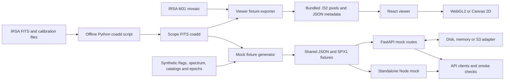

# Star Drift implementation report

Snapshot of `main` at `f222d0b`, audited November 13, 2026. The [Phase 1–2 functional overview](Star_Drift_Functional_Overview_and_Developer_Workflow_Phases_1%E2%80%9321.md) defines the target product and its acceptance criteria. The [SPHEREx data spike](spherex-data-spike.md) records the archive experiments. The [ticket tracker](../track.txt) records Developer C's progress. The statuses below reflect the code in this checkout and the checks described at the end.

## What you can use today

Open the sky explorer and choose **Scope field** or **M31**. Both show real SPHEREx brightness data at 0.809 µm, detector 1, channel 4. You can change how the image is displayed, pan and zoom, read coordinates under the pointer, inspect the bundled observation metadata, and copy a link that restores the sample and view settings. The browser fetches the bundled image as a static asset. The FastAPI and Node mock servers can be used independently to develop and test API consumers.

| Milestone from §13 | Status in this checkout |
| --- | --- |
| M0 · Real-data spike | The script and checked-in FITS products demonstrate a real single-band coadd. Survey epoch boundaries, sustained archive request limits, and independent photometric comparison remain open. |
| M1 · Static viewer | Working for Scope and M31. View URLs restore the bundled sample, display settings, pan, and zoom. |
| M2 · Backend cutouts | The API serves a fixed test image, with a working cache for binary responses. The arbitrary-position cutout pipeline, viewer API client, and field-of-view input are pending. |
| M3–M5 · Time, catalogs, and bands | Mock data and contract fields cover some inputs. Epoch switching, blink, subtraction, search, overlays, band selection, and detector stacks are pending. |
| M6–M7 · Spectra, flags, and WISE | The API exposes fixture responses. Live spectral extraction, source cards, a spectrum plot, an aligned flag overlay, and WISE display are pending. |
| M8 · Hardening | Local tooling, tests, responsive CSS, keyboard navigation, and recovery states exist. Production deployment, end-to-end checks, and the performance and accessibility acceptance targets remain open. |

## Architecture and data flow



The offline processing path already produces science pixels from downloaded data. The browser path reads prepared pixels. The mock HTTP path demonstrates the intended network shape, including compression and caching. In the target architecture in §§4–5, the browser calls `/api/cutout` and a cache miss runs the live exposure search and processing path. Today the browser can run with FastAPI stopped, and a FastAPI cache miss reads the checked-in Scope response.

### 1. From FITS exposure to coadd

Right ascension (RA) and declination (Dec) identify a sky position. The World Coordinate System (WCS) maps image pixels to those coordinates. A cutout is a cropped image. A coadd combines overlapping, aligned exposures. The SPHEREx exposure format matters because wavelength varies across each detector. A channel map identifies pixels belonging to a nominal band, and separate calibration planes provide their wavelengths and bandwidths. The archive observation time is carried in Modified Julian Date (MJD). [Data spike findings](spherex-data-spike.md#findings-for-implementation)

1. The commands in the spike note use IRSA SIA2 to search around a position and download cropped Level 2 FITS products and calibration files. The checked-in Level 2 sample has a 70 × 70 science plane and includes `IMAGE`, `FLAGS`, `VARIANCE`, `ZODI`, `EPSF`, and `WCS-WAVE`. The coadd script takes local files as inputs. [Spike reproduction commands](spherex-data-spike.md#reproduce)
2. `coadd()` builds a north-up ICRS tangent-plane (TAN) grid centered on the requested RA and Dec, at 6.15 arcsec per pixel. The alternate FITS WCS locates the cutout in detector coordinates so the script can index `CHANNEL_MAP`, `CWAVE`, and `CBAND`. It subtracts the archive's `ZODI` plane, selects the requested detector subchannel, and excludes invalid samples and selected 32-bit quality flags. Bit 21, the known-source marker, is preserved by the masking policy. [Coadd script](../scripts/spherex_spike.py)
3. `reproject_exact()` maps brightness and a validity plane to the output grid separately. The script accumulates overlap-weighted brightness, divides by valid coverage, and records the contributing exposure count per pixel. The output FITS has a float32 primary image in MJy/sr, an `NHITS` plane, and an `EXPOSURES` table with input names, times, and wavelength bounds. Uncovered pixels are NaN. [Coadd script](../scripts/spherex_spike.py)

| Image | Origin | Geometry and provenance |
| --- | --- | --- |
| Scope | Local QR3 coadd at 150.12°, 2.34° | 36 × 36, 0.0615° wide. D1 channel 4 at 0.809 µm. Both exposures are recorded. All 1,296 pixels have coverage and 108 have two contributions. |
| Deep | Local QR3 coadd at 270°, 66.56° | 36 × 36. D1 channel 14 at 1.025 µm. All 1,296 pixels have coverage and 1,273 have two contributions. This sample exercises coaddition and stays in the science fixtures. |
| M31 | A single plane exported from an IRSA Mosaic Tool FITS | 293 × 293, about 0.500542° wide, centered at 10.68479292°, 41.269065°. D1 channel 4 at 0.809 µm. The bundled metadata has an empty exposure-time list and a null release. |

The spike handles one detector and subchannel per run. It applies the quality mask before science reprojection and leaves production flag-plane alignment, variance propagation, photometric normalization, and multi-epoch selection for later tickets. The two coadd products are under [FITS fixtures](../shared/fixtures/spherex/). The browser files come from [the fixture exporter](../scripts/export_viewer_fixture.py), which checks for a north-up, east-left ICRS TAN grid and writes JSON plus little-endian float32 bytes. For M31 it selects the requested wavelength plane and uses `NHITS` to mark uncovered pixels as NaN.

### 2. From URL to rendered image

| Code | Role |
| --- | --- |
| [main.tsx](../frontend/src/main.tsx) and [App.tsx](../frontend/src/App.tsx) | Mount React, choose landing page or explorer, and coordinate browser location changes. The shell persists English/French and light/dark preferences in local storage. The share dialog copies the current URL and offers manual selection if clipboard access fails. |
| [viewState.ts](../frontend/src/viewer/viewState.ts) | `readView()` parses and validates the query string and checks it against the bundled positions, widths, and band. `viewerHref()` serializes the sample, coordinates, display options, and local navigation. Control changes use `history.replaceState()` without a page reload. Epoch and difference requests make a view unavailable. |
| [Viewer.tsx](../frontend/src/viewer/Viewer.tsx) and [cutout.ts](../frontend/src/viewer/cutout.ts) | The viewer starts an abortable asset fetch for a supported sample. `loadCutout()` checks the byte count against the JSON dimensions, reads little-endian floats, and returns a `Cutout`. The workspace has loading, retry, and unsupported-view recovery states. The details panel displays center, angular width, scale, band, wavelength, detector, and exposure times and release when supplied. |
| [SkyImage.tsx](../frontend/src/viewer/SkyImage.tsx) and [webgl.ts](../frontend/src/viewer/webgl.ts) | The preferred renderer uploads brightness to an `R32F` texture and coverage to a separate `R8` validity texture. The fragment shader maps brightness to display color. Display-only controls update shader settings without fetching or reuploading the original image. Toggling gradient subtraction creates a new display array. A new canvas provides a Canvas 2D fallback when WebGL initialization, upload, or context fails. |
| [image.ts](../frontend/src/viewer/image.ts) | Implements the display math and CPU fallback. It clips by finite-pixel percentiles, defaults to asinh with 1st/99th-percentile limits, and supports linear, log, and asinh stretches, adjustable nonlinear strength, and grayscale or Viridis. Optional gradient subtraction estimates a plane from median differences between neighboring pixels. Missing samples stay transparent. A diverging palette exists internally for a future difference view. |
| [navigation.ts](../frontend/src/viewer/navigation.ts) | `moveView()` clamps zoom to 1×–8× and keeps the anchor under the pointer during zoom. `skyAtPoint()` reverses the pan and zoom, converts canvas positions to FITS pixel centers, and inverts the TAN projection to get RA and Dec. `skyScaleBar()` converts the displayed image width and WCS pixel scale into an angular scale. |

Drag, wheel, pinch, zoom buttons, and keyboard controls operate on the current image. The compass and scale bar reflect its north-up orientation and local zoom. Changing the URL's requested sky position or field of view can leave the bundled view, in which case the app explains the unsupported selection and links back to Scope and M31. There is no live sky lookup behind that state. Responsive layout and focus styling live in [App.css](../frontend/src/App.css) and [index.css](../frontend/src/index.css).

### 3. From HTTP request to fixture

FastAPI is mounted in [main.py](../backend/app/main.py) and includes [mock_router.py](../backend/app/mock_router.py) under `/api`. Vite proxies `/api` to the configured backend, defaulting to local port 8000. The standalone [Node mock](../shared/mock_server.mjs) serves the same fixture directory on port 8000 by default and has simpler validation. It can be run instead of FastAPI with `npm run mock` from `frontend`. [Vite configuration](../frontend/vite.config.ts)

| FastAPI route | Current behavior |
| --- | --- |
| `GET /api/health` | Returns `{"status":"ok"}` for process health. |
| `GET /api/meta` | Reads static QR3 metadata with a 0.05°–1.0° FoV range, 102 bands across six detectors, and illustrative epoch entries. |
| `GET /api/cutout` | Validates query types and selected ranges. Binary mode serves the same Scope SPX1 bytes for valid requests and caches by view parameters. JSON mode reuses the Scope pixels and overrides the header center, band when supplied, and epoch. |
| `GET /api/flags` | Returns synthetic summary counts, categories, and bit definitions. The packed per-pixel test flags are in the SPX1 fixture. |
| `GET /api/spectrum` | Returns 102 synthetic flux points and echoes position, aperture, and epoch. |
| `GET /api/catalog` | Filters synthetic rows by catalog and optional magnitude. The radius is validated but is not used for a spatial cone filter. |
| `GET /api/resolve` | Looks up a few fixture names, case-insensitively and with whitespace trimmed. Unknown names return a typed 404. |
| `GET /api/cache/stats` and `POST /api/cache/invalidate?release=...` | Expose storage statistics and manual eviction of older release namespaces through the cache manager. |

The draft contract is checked in as [OpenAPI YAML](../shared/openapi.yaml) and [JSON](../shared/openapi.json), with shared [TypeScript types](../shared/types/api.ts). The two spec files parsed to the same object in this audit. The running app's `/docs` uses FastAPI's generated schema, which includes cache routes and default validation responses. For example, cutout coordinates outside the accepted range can produce a typed `400 INVALID_COORDINATES`, and an oversized FoV or invalid enum returns FastAPI's `422` detail format. The draft's uniform error envelope and status codes are still an integration task.

### 4. Two binary formats serve different paths

The viewer fixture is simply `width × height` little-endian float32 pixels with its own neighboring JSON metadata. Scope's array is 5,184 bytes. The API fixture adds framing, compression, a metadata header, and an optional flag plane.

```text
SPX1 | header length | UTF-8 JSON header | image length | gzip float32 pixels
     | optional flags length | gzip uint32 flags
```

Lengths are unsigned 32-bit big-endian values. The arrays use little-endian values. The sample header has version `1.0`, WCS, shape, units, wavelength, epoch, exposure count, flags summary, and release. The draft S4 ticket mentions uint16 flags. The implemented uint32 plane can represent high bits such as bit 28 observed in the QR3 sample. [Python encoder and decoder](../shared/payload.py)

The [TypeScript decoder](../shared/payload.ts) reads the header and returns flat `Float32Array` and optional `Uint32Array` values, with browser `DecompressionStream` or Node gzip support. The test vector decodes in both languages' tests. I also compared its 1,296 decoded brightness values against the viewer's Scope asset and found an exact match. The viewer uses `loadCutout()` for raw assets, so adapting SPX1 output into the viewer's `Cutout` model is a distinct piece of work. [Payload test](../frontend/src/utils/payload.test.ts) · [Mock fixture generator](../scripts/generate_mock_fixtures.py)

### 5. How a binary cutout is cached

1. `get_cutout()` passes the request to `CacheManager.get_view()`. `build_cache_key()` combines the data release, HEALPix sky tile and resolution, nearest FoV bucket, epoch, mode, band, detector, and mask flag. The standard buckets are 0.05°, 0.10°, 0.20°, 0.50°, and 1.00°. Requests in the same tile and bucket with matching selections can reuse an entry. [Cache keys](../backend/app/cache/keys.py) · [HEALPix indexing](../backend/app/cache/healpix.py)
2. The default storage is `data/cache` relative to the backend process, with a seven-day TTL and a 500 MB configured size cap. Disk storage uses release and tile directories, hashed file names, separate binary and JSON files, and least-recently-used eviction. `CACHE_TYPE=memory` selects an in-process cache. `CACHE_TYPE=s3` uses the optional `boto3` client when configured and supports disk fallback. The S3 adapter's release invalidation currently purges the fallback store only. [Cache manager](../backend/app/cache/manager.py) · [Disk](../backend/app/cache/disk.py) · [Memory](../backend/app/cache/memory.py) · [S3](../backend/app/cache/s3.py)
3. A miss loads the bundled SPX1 file and stores it. The response carries `X-Cache: MISS` or `HIT`, an ETag derived from the bytes, `Cache-Control`, and `X-Data-Release`. Matching `If-None-Match` returns `304` with an empty body. Old release entries can be purged manually, and the current release constant remains `spherex_qr3`. [Binary route](../backend/app/mock_router.py) · [Cache entry metadata](../backend/app/cache/base.py)

## Ticket coverage against §16

| Tickets | Implemented scope and outstanding acceptance |
| --- | --- |
| **S1** | Monorepo, Docker Compose, Ruff, ESLint, Prettier script, environment examples, PR template, and GitHub Actions. Compose runs FastAPI with the integrated mocks plus Vite. The separate Node mock and pre-commit hooks are outside the current Compose/setup configuration. |
| **S2, S4** | Data spike, real sample products, documented assumptions and open questions, plus the versioned SPX1 code and fixture. The report's format description complements the code. Survey windows, production quotas, and independent photometric checks remain open. |
| **S3** | Draft schema, TypeScript types, fixtures, and both mock servers are present. Rendering a fetched SPX1 response in the app remains open, and the checked-in draft and running schema differ. |
| **A1–A5** | A1 search and A2 extraction are demonstrated through the spike's manual SIA2/cutout commands. A2 FITS reading, A3 band selection, A4 science reprojection, and A5 weighted single-channel coaddition work in the offline script. Reusable service modules, the full processing modes, and the ticket acceptance tests are pending. |
| **A6–A11** | A6 has a fixture-backed route and cache. A7 retains sample timestamps with illustrative epoch metadata. A8 has offline masking and mock flags. A9 has a synthetic spectrum. A10 production latency/retry behavior and A11 reference-star normalization remain open. |
| **B1–B5** | B1 URL-driven shell, B2 float renderer and fallback, B3 display controls, and B4 local navigation are implemented for bundled images. B4 does not fetch a new field on zoom. B5 has the asset loader, cancellation, loading/retry UI, and standalone SPX1 decoder. The API data client, typed-error mapping, and recent-view cache remain open. |
| **B6–B13** | B6 blink, B7 difference, B8 server FoV control, B9 catalogs, B10 bands/stacks, B11 click-to-spectrum, and B12 flag overlay/mask controls remain open. B13 has responsive CSS, accessible control labels, focus styles, and keyboard navigation. A browser accessibility audit and the full B13 acceptance checks remain open. |
| **C1–C5** | C1 works locally for binary mock cutouts, with gaps in HEALPix fallback equivalence and remote invalidation. C2 serves static metadata with manual invalidation. C3 has basic request validation and some typed errors. Uniform validation responses, rate limits, structured request logs, release detection, and live C4/C5 catalog/name queries remain open. |
| **C6–C13** | C7 observation details and C10 copy-link sharing are partial. Source card, search, Aladin Lite, spectrum chart/CSV, iframe mode, staging/CDN/alerts, optional solar-system ephemeris, and full end-to-end/load/accessibility tests remain open. C11 has local container and health-check foundations. The PNG files in [frontend/mockups](../frontend/mockups/) are design references. |

## Findings that affect the next integration

- The mock API will happily return Scope bytes for an M31 request. I verified that an M31 request with a different band, mode, and epoch returned the same binary body and ETag as Scope. JSON mode changed the center, epoch, and band to 42 while preserving the Scope wavelength of 0.809 µm. These responses are suitable as fixtures and cannot validate scientific selections. [Mock router](../backend/app/mock_router.py)
- Some fixture metadata is internally inconsistent. The packed flags and flags endpoint both report 16 known-source pixels, while the SPX1 header summary says 108. Mock Epoch 1 starts at MJD 61150.0, which converts to April 20, 2026 UTC, while the same fixture says May 1, 2026 UTC. Those values should be resolved before tests rely on them as science or time references. [Mock generator](../scripts/generate_mock_fixtures.py) · [Metadata fixture](../shared/fixtures/mock/meta.json)
- The pure-Python HEALPix fallback gives different RING tile IDs from `astropy_healpix` at some positions. For the Scope center at NSIDE 64, I measured 39914 in the fallback and 23530 in the library. The existing tests check basic range and normalization behavior and do not catch this difference. This can change which cache entries are reused between environments. [Indexing code](../backend/app/cache/healpix.py) · [Cache tests](../scripts/test_cache_layer.py)
- The cache's tile and FoV quantization is currently safe for a fixed mock image. Before storing real cutouts, the view's WCS and size need to agree with the cache identity. If two positions share a key but get independently centered grids, the later request could receive the earlier grid. The S3 path also needs a live integration check, and the cache stats and invalidation routes need production access controls. [Cache keys](../backend/app/cache/keys.py) · [Cache routes](../backend/app/mock_router.py)

## Verification and reproduction

| Check | Result |
| --- | --- |
| Backend and scripts Ruff checks | Passed. |
| Backend pytest | 8 passed. The installed Starlette emits a TestClient/httpx deprecation warning. |
| Standalone cache and contract checks | 12 passed with `PYTHONPATH=backend` from the repository root. |
| Frontend ESLint, Vitest, and production build | Passed. Vitest ran 26 tests across six files. The installed Node version was 26.0.0. The repository pins 24.15.0 for CI. |
| HTTP and science fixture smoke checks | Called the FastAPI app through TestClient and launched the actual Node mock. Confirmed response shapes, SPX1 magic, FastAPI `MISS → HIT → 304`, and the known/unknown name cases. Read both coadds with Astropy and verified their FITS checksums and hit counts. |
| Docker Compose | Configuration validated. The Docker daemon was unavailable for image builds and runtime checks. |

The Vitest HTTP suite creates its own temporary server and is separate from the deployed Node or Python router. The React tests run in jsdom and exercise the Canvas 2D fallback with stubs. The audit did not run hardware WebGL, real S3, a new IRSA download, browser E2E, load testing, or a live CI run. [CI workflow](../.github/workflows/ci.yml)

To see the two runtime paths yourself, start the backend and frontend as described in the [repository README](../README.md). Open the explorer in the frontend to try both bundled samples. In a separate PowerShell window, try the API directly:

```powershell
Invoke-RestMethod http://127.0.0.1:8000/api/meta
Invoke-RestMethod 'http://127.0.0.1:8000/api/cutout?ra=150.12&dec=2.34&format=json'
Invoke-RestMethod 'http://127.0.0.1:8000/api/resolve?name=Vega'
```
